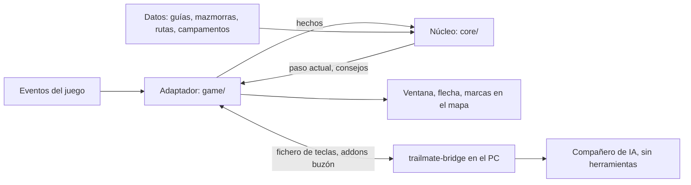

# TrailMate

[English](README.md) · **Español**

Un entrenador de subida de nivel para **World of Warcraft: Forever** (versión 1.60 del juego, interfaz 16001). Te lleva por guías de misiones con su propia flecha y una línea de puntos en el mapa. Te dice qué aprender en el instructor de clase, qué talento coger después y qué vender, guardar o subastar en el vendedor, y te explica por qué.

**Aconseja, nunca juega.** TrailMate no pulsa teclas, no mueve a tu personaje, no compra, no vende, no aprende hechizos ni gasta puntos de talento. Lee el juego y muestra texto, una flecha y marcas en el mapa; cada acción es tuya.

**No necesita ningún otro addon.** La flecha, las marcas del minimapa y del mapa del mundo, las guías y el planificador de viajes son suyos. Puedes tener otros addons instalados; TrailMate no los usa.

> **Estado: alfa (0.1.0-alpha).** Se juega y se prueba con un solo personaje, un cazador de la Horda entre los niveles 33 y 35, así que habrá cosas por pulir: mira los [problemas conocidos](#problemas-conocidos). Los avisos de fallos y las pull requests son bienvenidos, en inglés o en español ([CONTRIBUTING.es.md](CONTRIBUTING.es.md)). Sin relación con Blizzard Entertainment.

## Qué hace hoy

| Función | Cómo |
|---|---|
| Guías de misiones | 78 guías para las dos facciones, del nivel 1 al 60, dentro del addon (`/tm guía`). Elige la de tu nivel y tu raza, y pasa a la siguiente cuando terminas. Cada paso es coger, hacer o entregar, con el sitio de quien da la misión, del objetivo o de la entrega. Las misiones opcionales van marcadas. Las fuentes de los datos están más abajo. |
| Una ruta con tu diario | Sin guía, `/tm diario` ordena tus misiones por nivel con los colores del juego, elige **una zona** y hace la ruta de la más cercana a la más lejana. Te dice qué dejar para más tarde (demasiado difícil, de grupo o élite), qué te conviene abandonar y qué zonas vienen después. |
| Elegir paso | La ventana lista los próximos pasos; pulsa uno (o `/tm elegir 3`) para hacerlo primero. Los pasos se marcan solos con lo que pasa en el juego. |
| Flecha | La flecha de TrailMate apunta al paso actual con la distancia, según hacia dónde miras, y cambia de color cuando te giras. Si un paso necesita un objeto (tu piedra de hogar o un objeto de misión), aparece un botón para usarlo junto a la flecha y en la ventana. |
| Marcas en el mapa | Un alfiler morado en el minimapa con la punta en el objetivo, para que se sigan viendo las marcas de misión del juego que hay debajo; si el objetivo está fuera del minimapa, una flechita morada en el borde. El mismo alfiler en el mapa del mundo. |
| Línea de puntos | En el mapa del mundo, puntos por el camino hasta el objetivo, como una ruta andada. TrailMate aprende los caminos que recorres (`/tm rastro`) y la flecha los sigue, así rodea muros y sube rampas en vez de atravesar una ciudad en línea recta. El addon puede traer caminos ya andados por las capitales; todavía no trae ninguno. |
| Al llegar a un sitio nuevo | Al llegar a un campamento con misiones (por ejemplo, Grom'gol), primero te lista las misiones que coger allí y te propone poner la piedra de hogar. |
| Mazmorras por nivel | `/tm mazmorra` lista las mazmorras que te van por nivel y facción, con el nivel de sus enemigos en Forever y cuántas misiones conviene coger antes de entrar. `/tm mazmorra 2` prepara un plan: primero quien da cada misión, luego la entrada (la más cercana si hay dos) y después las entregas; al terminar, vuelves a tu guía. |
| Talentos | Junto a la ventana de talentos del juego: plantillas por clase (para el cazador, una build de subida 31/16/4 y una por rama). Al pasar el ratón por una plantilla, sale una miniatura de las tres ramas con el nivel al que se coge cada talento. El siguiente talento brilla en la ventana del juego, y cada talento que falta lleva una etiqueta con su nivel. |
| Recordatorios | Una barra arriba de la ventana cuando tienes las bolsas llenas (ve a vender), cuando subes de nivel (ve al instructor) y cuando tienes un punto de talento. Cada uno tiene un botón que pone la flecha hacia el sitio que toca. |
| Consejo en el instructor | Al abrir un instructor de clase: una lista numerada con *aprender*, *saltar* o *más tarde* para cada hechizo, y el motivo. Ignora un hechizo una vez (`/tm ignorar 3`) y no se te vuelve a recomendar, en ningún rango. Guarda la reserva de oro que tú elijas. |
| Consejo en el vendedor | Al abrir un vendedor: qué vender (y más o menos por cuánto), qué guardar y qué merece la pena en la casa de subastas. |
| Estrategia de subida | `/tm estrategia` lista las zonas que te van por nivel, cada una marcada como *fácil*, *normal* o *difícil*. Elige una (`/tm zona 2`) o deja que elija TrailMate (`/tm zona auto`). |
| Planificador de viajes | La forma más rápida de llegar a una zona: compara ir andando, los vuelos que tienes aprendidos, la piedra de hogar si está lista, y barcos o zepelines entre continentes (por ejemplo, de Orgrimmar a Grom'gol). |
| Aprende mientras juegas | Su propio atlas, compartido por tus personajes: quién da y quién recoge cada misión, instructores, vendedores, posaderos y maestros de vuelo, según lo que te ha enseñado el juego. |
| Chat con el compañero | `/tm chat` abre una ventana pequeña para hablar con tu compañero de IA sobre tu personaje. Tu pregunta va con tu estado actual (nivel, zona, plan, diario, siguiente talento), nunca con nombres. Necesita el programa puente en tu PC (mira más abajo). El compañero no tiene herramientas: solo contesta. |
| Icono del compañero | El icono es una medalla con aro dorado, una huella blanca y un sendero. El sendero toma el color de tu compañero de IA (`/tm compañero claude` o `chatgpt`). |
| Autotest | `/tm test` comprueba todo lo que se puede comprobar sin que hagas nada y escribe líneas PASS o FAIL en la pestaña Registro, listas para copiar. No cambia nada. |
| Panel y registro | `/tm` o el botón del minimapa abre un panel con las pestañas Ruta, Zonas, Instructor, Bolsas y Registro. Todo lo que dice TrailMate se guarda en el registro, que puedes seleccionar y copiar. |

El addon sale en el idioma de tu juego: español si el cliente está en español, y si no, en inglés.

## Instalación

1. Copia la carpeta `TrailMate` en `World of Warcraft/_forever_/Interface/AddOns/`.
2. Reinicia el juego (después de una actualización con imágenes nuevas, `/reload` no basta).
3. Pulsa el botón de TrailMate en el minimapa o escribe `/tm`. `/tm ayuda` lista los comandos; funcionan en inglés y en español (`/tm guide` o `/tm guía`).

### El chat con el compañero (opcional)

El addon no puede conectarse a internet, así que un programa pequeño en tu PC, `trailmate-bridge`, lleva los mensajes. Lee las preguntas que el juego guarda en su fichero de teclas y escribe las respuestas en unos addons pequeños que hacen de buzón. El cómo y el porqué están en el [ADR 0001](docs/adr/0001-companion-bridge.md) (en inglés); la idea viene de [Witchcraft](https://github.com/Geraldlol/witchcraft).

1. Inicia sesión una vez en Claude Code en una terminal (`claude`), con tu propia cuenta.
2. Crea los buzones y reinicia el juego:
   `trailmate-bridge init --game "C:\Program Files (x86)\World of Warcraft\_forever_"`
3. Mientras juegas, déjalo en marcha:
   `trailmate-bridge run --game "C:\Program Files (x86)\World of Warcraft\_forever_"`
   Añade `--companion echo` para comprobar el enlace sin preguntar a ningún modelo.
4. En el juego, una vez: `/tm chat local`. Mientras las teclas se sincronizan con los servidores de Blizzard, el juego no las escribe en tu PC y el puente no ve nada. `/tm chat sync` vuelve a activar la sincronización.
5. `/tm chat` y escribe. Si algo se queda parado, `/tm chat diag` dice qué tiene cada tecla.

El chat usa las teclas `Ctrl+Alt+Mayús+F1` a `F8` mientras sale un mensaje, y las deja libres después. Nunca toca una tecla que uses tú.

## Comandos

| Comando | Qué hace |
|---|---|
| `/tm guía [número\|siguiente\|auto\|no]` · `/tm guide` | Lista las guías, elige una, pasa a la siguiente, deja que elija TrailMate o planifica con tu diario |
| `/tm chat [pregunta]` | Habla con tu compañero de IA (necesita `trailmate-bridge` en tu PC) |
| `/tm mazmorra [número]` · `/tm dungeon` | Mazmorras para tu nivel, o un plan para una (primero las misiones, luego la entrada) |
| `/tm diario` · `/tm questlog` | Prepara un plan con tu diario de misiones |
| `/tm elegir <n>` · `/tm pick` | Haz ahora el paso n de la lista |
| `/tm salta` · `/tm skip` | Salta el paso actual |
| `/tm hecho` · `/tm done` | Marca el paso actual como hecho |
| `/tm deshaz` · `/tm undo` | Deshace la última marca |
| `/tm talentos` · `/tm talents` | Abre tus talentos y dice el siguiente |
| `/tm instructor` · `/tm trainer` | Consejo en el instructor abierto |
| `/tm ignorar <n\|nombre>` · `/tm ignore` | No vuelve a recomendar ese hechizo (en ningún rango) |
| `/tm aprendido <n\|nombre>` · `/tm learned` | Deja de recordarte un hechizo que ya tienes |
| `/tm recuperar <nombre>` · `/tm unignore` | Vuelve a recomendar un hechizo ignorado |
| `/tm ignorados` · `/tm ignored` | Lista los hechizos ignorados |
| `/tm vender` · `/tm vendor` | Qué vender, guardar o subastar |
| `/tm buscar instructor\|vendedor\|reparar\|vuelo` · `/tm find` | Flecha al más cercano que haya visto TrailMate |
| `/tm plan` | Flecha de vuelta al plan |
| `/tm estrategia` · `/tm strategy` | Las mejores zonas para tu nivel, con su dificultad |
| `/tm zona <n>\|auto` · `/tm zone` | Elige la zona donde subir, o deja que elija TrailMate |
| `/tm rastro si\|no\|ver\|exportar\|borrar` · `/tm trail` | Aprende los caminos que recorres y los sigue |
| `/tm flecha si\|no` · `/tm arrow` | Muestra u oculta la flecha |
| `/tm compañero claude\|chatgpt\|ninguno` · `/tm companion` | Color del icono según tu compañero de IA |
| `/tm estado` · `/tm status` | Resumen del personaje |
| `/tm rastreos si\|no` · `/tm tracking` | Aprende o salta los rastreos del cazador |
| `/tm reserva <oro>` · `/tm reserve` | Oro que el consejo del instructor nunca gasta |
| `/tm auto on\|off` | Rehace el plan solo cuando se acaba |
| `/tm mostrar` / `/tm ocultar` | Muestra u oculta la ventana |
| `/tm minimapa` | Muestra u oculta el botón del minimapa |
| `/tm opciones` | La página de TrailMate en Esc > Opciones > AddOns |
| `/tm borrar` · `/tm clear` | Quita el plan |
| `/tm test` | Autotest, escrito en el registro |
| `/tm diag` | Qué ofrece este cliente, para avisar de fallos (sin datos personales) |

## Cómo funciona



- `TrailMate/core/` es Lua 5.1 sin la API del juego: el formato del plan y su validador, el motor de pasos, el planificador del diario, las guías, los talentos, los viajes, la búsqueda de caminos (Dijkstra sobre los puntos andados) y los consejos del instructor y de las bolsas. Tiene tests completos fuera del juego.
- `TrailMate/game/` es un adaptador fino: lee el juego, convierte los eventos en hechos y dibuja la ventana, la flecha y las marcas del mapa. Antes de usar cada función del juego comprueba que existe, porque este cliente es nuevo.
- `TrailMate/data/` lo generan los scripts de `tools/`; nunca se edita a mano.
- Un plan son **solo datos** y se valida cada vez que se carga, así que nunca puede llevar código.

## De dónde salen los datos

- Las guías siguen el orden de las guías de subida de la comunidad para Forever hechas para [Guidelime](https://github.com/max-ri/Guidelime) (las guías TUGs). Las 1777 misiones que usan se han comprobado en la base de datos de Forever de Wowhead: las tres que no están se quitan.
- Los sitios de quien da cada misión, de los objetivos y de las entregas salen de la base de datos de misiones de [Questie](https://github.com/Questie/Questie) para Forever. TrailMate coge el punto de aparición más central de cada personaje u objeto.
- Las entradas de las mazmorras (en coordenadas de Forever), el nivel de sus enemigos y sus misiones salen de la misma base de datos; `tools/build_dungeons.lua` escribe `TrailMate/data/Dungeons.lua`. El rango de una mazmorra va del nivel que tienen la mayoría de sus enemigos a su jefe más fuerte.
- `tools/build_guides.lua` junta las dos cosas en `TrailMate/data/Guides.lua`. Cuando TrailMate ve en el juego a quien da una misión, gana el sitio que ha visto.

## Desarrollo

El addon necesita Lua 5.1 y LuaRocks; el puente, Go (sin más dependencias).

```bash
luarocks install --local busted 2.3.0-1
luarocks install --local luacheck 1.2.0-1
luacheck .
busted
cd bridge && go vet ./... && go test ./...
```

Las imágenes se dibujan con código, así que los tests las comprueban y se pueden rehacer cuando haga falta:

```bash
lua tools/make_arrow.lua   # media/Arrow.tga: la flecha, 128 ángulos
lua tools/make_icon.lua    # media/Icon*.tga: la medalla con la huella, una por compañero
lua tools/make_pin.lua     # media/Pin.tga: el alfiler del mapa
```

## Próximos pasos

- 0.1.0: versión instalable, con capturas.
- Más compañeros (ChatGPT con su propio programa de terminal), y que el compañero proponga planes como datos validados.
- Medir el acierto y el coste de los consejos.

## Problemas conocidos

Vistos en el juego con esta alfa; cada uno tiene su issue en GitHub.

- **La flecha sigue un camino andado antiguo.** Al salir de un sitio, puede seguir los puntos que grabó al entrar, y la vuelta se ve rara.
- **Zonas de misión.** En una misión que se hace en una zona grande, la flecha apunta al centro de la zona: si te mueves un poco dentro, te pide volver al centro. Si la misma misión se puede hacer en otra zona, la flecha sigue apuntando a la primera.
- **Elegir otro paso no se mantiene.** Si eliges otra misión en la ventana (o con `/tm elegir`), el plan vuelve enseguida a su propio orden, aunque estés al lado de la misión que elegiste.
- **El chat con el compañero no está confirmado de punta a punta.** La pregunta llega al puente (con `/tm chat local`); falta ver en el juego que la respuesta vuelve por los addons buzón.

## Limitaciones

- La llegada a un sitio es aproximada: las zonas tienen tamaños distintos y el radio va en unidades del mapa.
- Los sitios de las guías son el punto de aparición central de cada personaje; algunos pasos aún no tienen sitio y solo muestran su texto.
- Todavía no trae caminos andados: hasta que recorres un camino una vez, la flecha apunta en línea recta al objetivo.
- En WoW Forever el juego no les dice a los addons qué misiones hay sin coger ni dónde están los objetivos de las misiones: las guías y el atlas cubren ese hueco.
- El consejo del vendedor usa el nivel de objeto como guía aproximada para el equipo, no sus estadísticas.

## Proyectos relacionados

[Azeroth Companion](https://github.com/nardo86/azeroth-companion) (MIT) abrió el camino de un addon más un programa de escritorio para chatear con una IA dentro del juego. [Witchcraft](https://github.com/Geraldlol/witchcraft) (MIT) descubrió cómo llevar mensajes en los dos sentidos sin recargar en este cliente; el puente de TrailMate toma esa idea con código propio y no le da herramientas al modelo. TrailMate es ante todo un entrenador, y funciona sin ninguna IA.

## Licencia

[MIT](LICENSE).
