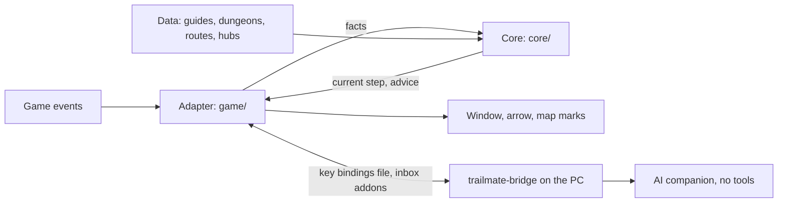

# TrailMate

**English** · [Español](README.es.md)

A leveling coach for **World of Warcraft: Forever** (game version 1.60, interface 16001). It walks you through quest guides with its own arrow and a dotted path on the map, tells you what to learn at the class trainer, which talent to take next and what to sell, keep or auction at a vendor, and explains why.

**It advises, it never plays.** TrailMate does not press keys, move your character, buy, sell, train or spend talent points. It reads the game and shows text, an arrow and marks on the map; every action is yours.

**It needs no other addon.** The arrow, the minimap and world map marks, the guides and the travel planner are all its own. Other addons can stay installed; TrailMate does not use them.

> **Status: alpha (0.1.0-alpha).** It is played and tested on one character, a Horde hunter between levels 33 and 35, so expect rough edges: see [Known issues](#known-issues). Reports and pull requests are welcome, in English or Spanish ([CONTRIBUTING.md](CONTRIBUTING.md)). Not affiliated with Blizzard Entertainment.

## What it does today

| Feature | How |
|---|---|
| Quest guides | 78 guides for both factions, from level 1 to 60, built into the addon (`/tm guide`). It picks the one for your level and race, and moves to the next when you finish. Every step is pick up, do or turn in, with the place of the quest giver, the objective or the turn-in. Optional quests are marked. Data sources are listed below. |
| A route from your quest log | Without a guide, `/tm questlog` sorts your quests by level like the game colours them, picks **one zone** to work in, and routes it nearest first. It says what to leave for now (too hard, group or elite), what to consider abandoning and which zones come later. |
| Choose your step | The window lists the next steps; click one (or `/tm pick 3`) to do it first. Steps tick themselves off from game events. |
| Arrow | TrailMate's own arrow points at the current step with the distance, using your facing, and changes colour as you turn away from it. When a step needs an item (your hearthstone, a quest item), a button to use it appears next to the arrow and in the window. |
| Map marks | A purple pin on the minimap with its tip on the target, so the game's quest marks underneath stay visible; when the target is off the minimap, a small purple arrow on its edge. The same pin on the world map. |
| Dotted path | On the world map, dots along the way to the target, like a walked route. TrailMate learns the paths you walk (`/tm trail`) and the arrow follows them, so it goes round walls and up ramps instead of straight through a city. The addon can ship walked paths through the capitals; none are included yet. |
| Arriving somewhere new | Reaching a quest hub (for example Grom'gol), it first lists the quests to pick up there and offers to set your hearthstone. |
| Dungeons by level | `/tm dungeon` lists the dungeons that suit your level and faction, with the level of their enemies in Forever and how many quests to pick up before going in. `/tm dungeon 2` plans one: the quest givers first, then the entrance (the nearest one when there are two), then the hand-ins; afterwards you are back on your guide. |
| Talents | Next to the game's talent window: templates per class (for hunters, a 31/16/4 leveling build and one per tree). Hovering a template shows a small picture of the three trees with the level each talent is taken at. The next talent glows in the game's window, and every talent still to come is labelled with its level. |
| Reminders | A bar at the top of the window when your bags are full (go and sell), when you level up (visit the trainer) and when you have a talent point. Each one has a button that points the arrow at the right place. |
| Trainer advice | When you open a class trainer: a numbered list with *learn*, *skip* or *later* for each spell, and the reason. Ignore a spell once (`/tm ignore 3`) and it is never recommended again, in any rank. Keeps a gold reserve you choose. |
| Vendor advice | When you open a vendor: what to sell (and roughly for how much), what to keep, and what is worth the auction house. |
| Leveling strategy | `/tm strategy` lists the zones that suit your level, each marked *easy*, *normal* or *hard*. Pick one (`/tm zone 2`) or let TrailMate choose (`/tm zone auto`). |
| Travel planner | The quickest way to a zone, comparing walking, flights you have learned, your hearthstone when it is ready, and ships or zeppelins across continents (Orgrimmar to Grom'gol, for example). |
| Learns as you play | Its own atlas, shared by your characters: quest givers, turn-ins, trainers, vendors, innkeepers and flight masters, from what the game showed you. |
| Companion chat | `/tm chat` opens a small window to talk to your AI companion about your character. Your question goes with your current state (level, zone, plan, quest log, next talent), never names. It needs the bridge program running on your PC (see below). The companion has no tools: it only answers. |
| Companion icon | The icon is a round badge with a gold ring, a white paw print and a winding trail. The trail takes the colour of your AI companion (`/tm companion claude` or `chatgpt`). |
| Self-test | `/tm test` checks everything that can be checked without you doing anything and writes PASS or FAIL lines to the Log tab, ready to copy. It changes nothing. |
| Panel and log | `/tm` or the minimap button opens a panel with Route, Zones, Trainer, Bags and Log tabs. Everything TrailMate says is kept in the log, which you can select and copy. |

The addon speaks your game's language: Spanish when the client is in Spanish, English otherwise.

## Install

1. Copy the `TrailMate` folder into `World of Warcraft/_forever_/Interface/AddOns/`.
2. Restart the game (after an update with new pictures, `/reload` is not enough).
3. Click the TrailMate button on the minimap, or type `/tm`. `/tm help` lists the commands; English and Spanish both work (`/tm guide` or `/tm guía`).

### The companion chat (optional)

The addon cannot reach the internet, so a small program on your PC, `trailmate-bridge`, carries the messages. It reads the questions the game saves in its key bindings file and writes the answers into small inbox addons. How and why is in [ADR 0001](docs/adr/0001-companion-bridge.md); the idea comes from [Witchcraft](https://github.com/Geraldlol/witchcraft).

1. Sign in once to Claude Code in a terminal (`claude`), with your own account.
2. Make the inboxes, then restart the game:
   `trailmate-bridge init --game "C:\Program Files (x86)\World of Warcraft\_forever_"`
3. While you play, keep it running:
   `trailmate-bridge run --game "C:\Program Files (x86)\World of Warcraft\_forever_"`
   Add `--companion echo` to check the link without asking a model.
4. In the game, once: `/tm chat local`. While key bindings sync with Blizzard's servers, the game does not write them on your PC, so the bridge sees nothing. `/tm chat sync` turns syncing back on.
5. `/tm chat` and write. `/tm chat diag` shows what each key holds if something is stuck.

The chat uses the keys `Ctrl+Alt+Shift+F1` to `F8` while a message goes out, and frees them afterwards. It never touches a key you use.

## Commands

| Command | What it does |
|---|---|
| `/tm guide [number\|next\|auto\|off]` · `/tm guía` | List the guides, choose one, go to the next, let TrailMate choose, or plan from your quest log |
| `/tm chat [question]` | Talk to your AI companion (needs `trailmate-bridge` on your PC) |
| `/tm dungeon [number]` · `/tm mazmorra` | Dungeons for your level, or a plan for one (quests first, then the entrance) |
| `/tm questlog` · `/tm diario` | Build a plan from your quest log |
| `/tm pick <n>` · `/tm elegir` | Do step n of the list now |
| `/tm skip` · `/tm salta` | Skip the current step |
| `/tm done` · `/tm hecho` | Mark the current step as done |
| `/tm undo` · `/tm deshaz` | Undo the last mark |
| `/tm talents` · `/tm talentos` | Open your talents and say the next one |
| `/tm trainer` · `/tm instructor` | Advice at the open trainer |
| `/tm ignore <n\|name>` · `/tm ignorar` | Never recommend that spell again (all ranks) |
| `/tm learned <n\|name>` · `/tm aprendido` | Stop reminding a spell you already have |
| `/tm unignore <name>` · `/tm recuperar` | Recommend an ignored spell again |
| `/tm ignored` · `/tm ignorados` | List ignored spells |
| `/tm vendor` · `/tm vender` | What to sell, keep or auction |
| `/tm find trainer\|vendor\|repair\|flight` · `/tm buscar instructor\|vendedor\|reparar\|vuelo` | Arrow to the nearest one TrailMate has seen |
| `/tm plan` | Arrow back to the plan |
| `/tm strategy` · `/tm estrategia` | Best zones for your level, with difficulty |
| `/tm zone <n>\|auto` · `/tm zona` | Choose the zone to level in, or let TrailMate choose |
| `/tm trail on\|off\|show\|export\|clear` · `/tm rastro` | Learn the paths you walk and follow them |
| `/tm arrow on\|off` · `/tm flecha si\|no` | Show or hide the arrow |
| `/tm companion claude\|chatgpt\|none` · `/tm compañero` | Icon colour of your AI companion |
| `/tm status` · `/tm estado` | Character summary |
| `/tm tracking on\|off` · `/tm rastreos si\|no` | Learn or skip hunter tracking spells |
| `/tm reserve <gold>` · `/tm reserva <oro>` | Gold the trainer advice never spends |
| `/tm auto on\|off` | Rebuild the plan by itself when it ends |
| `/tm show` / `/tm hide` | Show or hide the window |
| `/tm minimap` | Show or hide the minimap button |
| `/tm options` | TrailMate's page in Esc > Options > AddOns |
| `/tm clear` · `/tm borrar` | Remove the plan |
| `/tm test` | Self-test, written to the log |
| `/tm diag` | What this client exposes, for bug reports (no personal data) |

## How it works



- `TrailMate/core/` is plain Lua 5.1 with no game API: the plan format and its validator, the step engine, the quest-log planner, the guides, talents, travel and path finding (Dijkstra over the walked dots), and the trainer and bag advisors. It is fully tested outside the game.
- `TrailMate/game/` is a thin adapter: it reads the game, turns events into facts and draws the window, the arrow and the map marks. Every game function is feature-detected, because this client is new.
- `TrailMate/data/` is generated by the scripts in `tools/` and never edited by hand.
- A plan is **pure data** and is validated every time it is loaded, so a plan can never carry code.

## Data sources

- The quest guides follow the order of the community leveling guides for Forever written for [Guidelime](https://github.com/max-ri/Guidelime) (the TUGs guides). All 1777 quests they use were checked against Wowhead's Forever database: the three it does not have are left out.
- Quest giver, objective and turn-in places come from the quest database of [Questie](https://github.com/Questie/Questie) for Forever. TrailMate takes the most central spawn of each NPC or object.
- Dungeon entrances (in Forever's coordinates), the level of the enemies inside and the dungeon quests come from the same database; `tools/build_dungeons.lua` writes `TrailMate/data/Dungeons.lua`. A dungeon's range runs from the level most of its enemies have to its strongest boss.
- `tools/build_guides.lua` turns both into `TrailMate/data/Guides.lua`. When TrailMate sees a quest giver in the game, the place it saw wins.

## Development

The addon requires Lua 5.1 and LuaRocks; the bridge, Go (no other dependencies).

```bash
luarocks install --local busted 2.3.0-1
luarocks install --local luacheck 1.2.0-1
luacheck .
busted
cd bridge && go vet ./... && go test ./...
```

The pictures are drawn by code, so they can be checked by tests and rebuilt at any time:

```bash
lua tools/make_arrow.lua   # media/Arrow.tga: the arrow, 128 angles
lua tools/make_icon.lua    # media/Icon*.tga: the badge with the paw, one per companion
lua tools/make_pin.lua     # media/Pin.tga: the map pin
```

## Roadmap

- 0.1.0: installable release, screenshots.
- More companions (ChatGPT through its own CLI), and the companion proposing plans as validated data.
- Measured accuracy and cost of the advice.

## Known issues

Seen in the game with this alpha; each one has an issue on GitHub.

- **The arrow follows an old walked path.** After leaving a place, it can keep following the dots recorded on the way in, and the way back looks odd.
- **Quest areas.** For a quest done in a large area, the arrow points at the area's middle: moving a little inside the area asks you to go back to the middle. When the same quest can be done in another area, the arrow still points at the first one.
- **Choosing another step does not stick.** Picking a different quest in the window (or `/tm pick`) is soon taken back by the plan's own order, even when you stand next to the quest you chose.
- **The companion chat is not confirmed end to end.** The question reaches the bridge (with `/tm chat local`); the answer through the inbox addons still has to be seen working in the game.

## Limitations

- Arrival at a place is approximate: zones have different sizes and the radius is in map units.
- Guide positions are the central spawn of each NPC; a few steps have no place yet and show only their text.
- No walked paths ship yet: until you walk a path once, the arrow points straight at the target.
- On WoW Forever the game does not tell addons about quests you have not picked up yet, nor where quest objectives are: guides and the atlas fill that gap.
- The vendor advice uses item level as a rough guide for gear, not stats.

## Related work

[Azeroth Companion](https://github.com/nardo86/azeroth-companion) (MIT) pioneered the addon-plus-desktop-app pattern for in-game AI chat. [Witchcraft](https://github.com/Geraldlol/witchcraft) (MIT) found how to carry messages both ways without a reload on this client; TrailMate's bridge takes that idea with its own code and gives the model no tools. TrailMate is a coach first, and works without any AI.

## License

[MIT](LICENSE).
